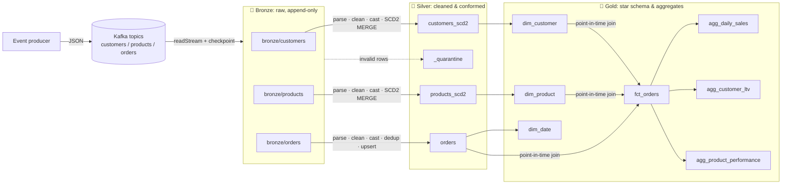
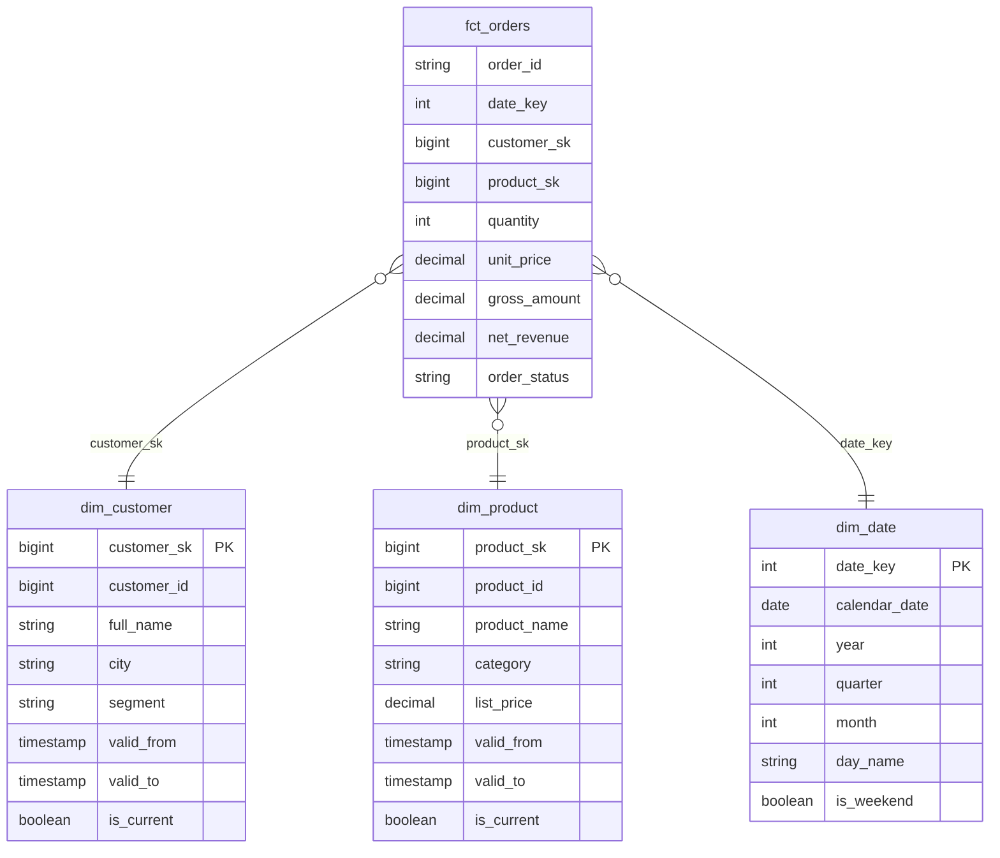

# Kafka → Delta Lake Medallion Lakehouse

[](https://github.com/mdey004/kafka-medallion-lakehouse/actions/workflows/ci.yml)


A streaming data pipeline that reads **customers, products and orders** events from **Kafka**. It refines them through a three-layer **medallion architecture (Bronze → Silver → Gold)** on **Delta Lake** with **PySpark Structured Streaming**.

| Layer | What happens | Tables |
|---|---|---|
| 🥉 **Bronze** | Raw Kafka records land append-only with full lineage (topic, partition, offset, timestamps) | `bronze/customers`, `bronze/products`, `bronze/orders` |
| 🥈 **Silver** | JSON parsing, string cleaning, **explicit type casting**, data-quality quarantine, **deduplication**, **SCD Type 2** history, idempotent upserts | `customers_scd2`, `products_scd2`, `orders`, `_quarantine` |
| 🥇 **Gold** | **Star schema** (dimensions + fact with point-in-time keys) and **business aggregates** | `dim_customer`, `dim_product`, `dim_date`, `fct_orders`, `agg_daily_sales`, `agg_customer_ltv`, `agg_product_performance` |

---

## Architecture



### Gold star schema



See **[docs/ARCHITECTURE.md](docs/ARCHITECTURE.md)** for design decisions and trade-offs.

---

## Quick start

**Prerequisites:** Python 3.10+, Java 11 or 17, Docker. On Windows, run Spark inside WSL2, or install `winutils.exe` and set `HADOOP_HOME`.

```bash
# 1. Clone and install
git clone https://github.com/mdey004/kafka-medallion-lakehouse.git
cd kafka-medallion-lakehouse
python -m venv .venv && source .venv/bin/activate
pip install -r requirements-dev.txt && pip install -e .

# 2. Start Kafka (+ Kafka UI at http://localhost:8080)
docker compose up -d

# 3. Produce sample events (with deliberate duplicates, changes and bad records)
python producer/produce_events.py --customers 50 --orders 500

# 4. Run the medallion pipeline end-to-end
python -m medallion.cli all
```

Or use the Makefile: `make up produce pipeline`.

Run a single layer with `python -m medallion.cli bronze|silver|gold`. Add `--continuous` to keep the Bronze and Silver streams running instead of draining the available data and stopping.

### Explore the output

```python
from medallion.spark import get_spark

spark = get_spark(with_kafka=False)

spark.read.format("delta").load("lakehouse/gold/agg_daily_sales").show()

# Full SCD2 history for one customer
(
    spark.read.format("delta")
    .load("lakehouse/silver/customers_scd2")
    .filter("customer_id = 1")
    .orderBy("valid_from")
    .show(truncate=False)
)
```

---

## Transformations in detail

### 🥉 Bronze (`src/medallion/bronze.py`)
- `readStream` from each Kafka topic with a checkpoint. On restart the stream resumes at the last committed offset.
- Stores `payload` exactly as received, plus `kafka_key`, `topic`, `kafka_partition`, `kafka_offset`, `kafka_timestamp`, `ingested_at`.
- Partitioned by `ingest_date`. **Never updated**, so any downstream table can be rebuilt from it.

### 🥈 Silver (`src/medallion/silver/`)
Each Bronze micro-batch goes through `foreachBatch`:

1. **Parse**: `from_json` against an all-string contract (`schemas.py`). Malformed values can't be dropped silently at this step.
2. **Clean**: trim all strings, blank → `NULL`, lowercase emails.
3. **Cast**: `try_cast` to explicit types (`bigint`, `decimal(12,2)`, `timestamp`, …). A bad value becomes `NULL` instead of failing the job.
4. **Validate**: rows missing a required column go to `silver/_quarantine` with a `dq_reason` and the raw payload.
5. **Deduplicate**: `row_number()` per business key, latest event first, Kafka offset as tie-breaker. This removes producer retries.
6. **Load**:
   - **Customers / products → SCD Type 2** (`scd2.py`). A Delta `MERGE` with the "staged updates" pattern:
     - change detection on a SHA-256 hash of tracked attributes
     - old version closed with `valid_to` and `is_current = false`
     - new version opened, with a surrogate key `xxhash64(key, valid_from)`
     - handles several versions in one batch, no-op re-sends and late events
     - replay-safe (idempotent)
   - **Orders → upsert** keyed on `order_id`. An older event never overwrites a newer status.

| customer_id | city | valid_from | valid_to | is_current |
|---|---|---|---|---|
| 1 | London | 2026-01-01 | 2026-02-15 | false |
| 1 | Berlin | 2026-02-15 | *NULL* | **true** |

### 🥇 Gold (`src/medallion/gold/`)
- **Dimensions**:
  - `dim_customer` and `dim_product` keep the full SCD2 history, plus a `-1` *Unknown* member.
  - `dim_date` is a generated calendar.
- **Fact**: `fct_orders` at order-line grain. Each order joins to the dimension version that was **valid at `order_ts`** (point-in-time), so historical revenue is attributed to the customer's city or segment *at the time of purchase*. The fact also carries `gross_amount`, `net_revenue` (0 for cancelled/returned orders) and `is_revenue`.
- **Aggregates**:
  - `agg_daily_sales`: orders, unique customers, units, revenue and AOV per day. Days with no sales show as 0.
  - `agg_customer_ltv`: first/last order, order count, lifetime revenue, AOV and LTV rank, with *current* customer attributes.
  - `agg_product_performance`: units, revenue, average selling price and rank within category.

---

## Project structure

```
├── docker-compose.yml          # Kafka (KRaft) + Kafka UI
├── producer/produce_events.py  # Synthetic, deliberately messy events
├── src/medallion/
│   ├── config.py               # Env-driven config & lakehouse paths
│   ├── spark.py                # SparkSession with Delta + Kafka connector
│   ├── schemas.py              # Event contracts, cast map, DQ rules, SCD2 specs
│   ├── bronze.py               # Kafka → Bronze streaming ingest
│   ├── silver/
│   │   ├── transforms.py       # parse / clean / cast / validate / dedup / hash
│   │   ├── scd2.py             # SCD Type 2 Delta MERGE
│   │   └── jobs.py             # Bronze → Silver foreachBatch streams
│   ├── gold/
│   │   ├── model.py            # Dimensions, fact, aggregates (pure functions)
│   │   └── jobs.py             # Silver → Gold batch build
│   └── cli.py                  # `python -m medallion.cli <layer>`
├── tests/                      # pytest: transforms, SCD2 (on real Delta), gold model
├── docs/ARCHITECTURE.md
└── .github/workflows/ci.yml    # Lint + tests on every push / PR
```

## Configuration

All settings come from environment variables (see `.env.example`):

| Variable | Default | Purpose |
|---|---|---|
| `KAFKA_BOOTSTRAP_SERVERS` | `localhost:9092` | Kafka brokers |
| `KAFKA_STARTING_OFFSETS` | `earliest` | Where a *new* Bronze stream starts |
| `KAFKA_TOPIC_CUSTOMERS` / `_PRODUCTS` / `_ORDERS` | entity name | Topic names |
| `LAKEHOUSE_ROOT` | `./lakehouse` | Root path for Delta tables. Can be `s3a://`, `abfss://` or `dbfs:/` |

## Testing

```bash
make lint   # ruff check + ruff format --check
make test   # pytest (needs Java; runs a local Spark with Delta)
```

The suite covers:
- **cleaning and casting**, including malformed values
- **quarantine** routing
- **dedup** tie-breaking
- **SCD2**: initial load, a change, a no-op, several versions in one batch, a late event, replay idempotency, one current row per key
- **Gold**: point-in-time joins, the unknown member, `dim_date` coverage and aggregate maths

CI runs all of it on every push.

## Contributing

1. Create a branch, make your change, add or adjust tests.
2. `make lint test` must pass.
3. Open a PR. CI must be green before merge.

## License

[MIT](LICENSE)
